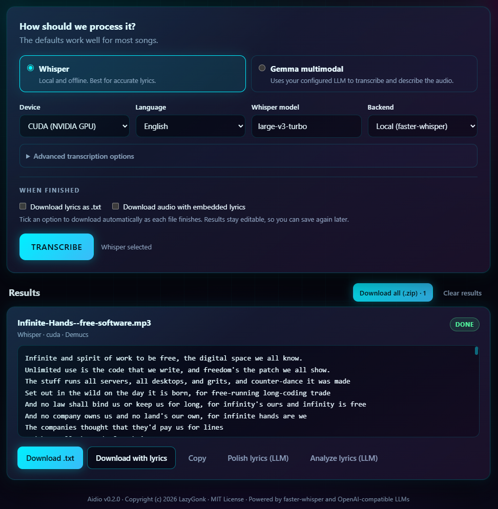

# Aidio

Audio analysis and lyrics transcription in one pipeline, with three interfaces
(CLI, batch CLI, web UI) and every LLM step optional.



*Screenshot uses "Infinite Hands" by Arne Babenhauserheide; the screenshot is
licensed GPL-3.0-or-later — see [docs/README.md](docs/README.md).*

> **Platform status:** developed and tested only on **Windows with an NVIDIA
> CUDA GPU** (torch 2.14.0+cu130). Linux, macOS, CPU-only and ROCm paths exist
> but are untested — expect rough edges, above all Demucs on CPU (very slow).

## What it does

- **Lyrics transcription** — offline faster-whisper (`large-v3-turbo`), optional
  Demucs vocal separation, optional LRC timestamps; writes `.txt`, embeds
  ID3v2 USLT tags, optional LLM post-correction.
- **Audio analysis** — chunked WAV to any OpenAI-compatible LLM (LM Studio,
  llama.cpp, LiteLLM, ...) for an instruments/genre/vocal/tempo/mood report.

```text
audio > [Demucs vocals] > Whisper > lyrics > [LLM correct] > .txt / USLT / JSON
                            └──────> [LLM analysis] > characteristics report
```

## Install

Requires Python 3.11+ and `ffmpeg`/`ffprobe` on PATH.

```powershell
python -m venv .venv
.venv\Scripts\Activate.ps1                     # cmd: .venv\Scripts\activate.bat
                                               # Linux/macOS: source .venv/bin/activate

pip install torch --index-url https://download.pytorch.org/whl/cu130   # tested build; match your driver
pip install -e ".[gpu]"                        # transcription, Demucs, cuBLAS 12 on Windows
pip install -e ".[gpu,embed]"                  # + ID3/FLAC/M4A tags (GPLv2+ mutagen)
# CPU-only: pip install -e ".[transcribe]"     # add ,embed for tags
# dev:      pip install -e ".[dev,gpu]"        # add ,embed for tags
```

`requirements.lock` is a hash-pinned **Windows + CUDA 13** set that also includes
the dev tools; it is for reproducing the tested GPU environment, not a general
installer. On CPU, ROCm, or other platforms use the extras above.

The `gpu` extra adds faster-whisper, Demucs and (on Windows)
`nvidia-cublas-cu12`: CTranslate2 is built against CUDA 12, while newer torch
wheels may bundle CUDA 13 (`cublas64_13.dll`). Aidio registers `torch/lib` and
`site-packages/nvidia/*/bin` before loading CTranslate2. If you still see
`Library cublas64_12.dll is not found or cannot be loaded`, run
`pip install "nvidia-cublas-cu12>=12,<13"` and restart, or switch to `--device cpu`.

ID3/FLAC/M4A tag embedding (`--embed`, *Download with lyrics*) requires the
`embed` extra, which pulls GPLv2+ mutagen - `transcribe`, `gpu` and `rocm` stay
free of copyleft code without it. `.txt` export and transcription work without
it.

First run downloads the Whisper model from Hugging Face (cached afterwards).

## Configure

`cp .env.example .env` — everything is optional; `.env` provides deployment
defaults, the web UI's Settings menu can override them per browser.

| Variable | Purpose | Default |
|---|---|---|
| `OPENAI_BASE_URL`, `OPENAI_API_KEY`, `ANALYSIS_MODEL` | LLM endpoint for analysis, correction and lyric analysis | `http://127.0.0.1:4000/v1`, `sk-not-needed-for-local`, `gemma4:12b` |
| `OPENAI_MODEL` | CLIs: model for LLM correction / lyric analysis (web UI uses its Settings model) | `gemma4:12b` |
| `AIDIO_DEVICE` | `cuda` / `cpu` / `rocm` (ROCm: Linux only) | `cuda` |
| `AIDIO_CORRECTION_PROMPT` | Power users: replace the built-in lyric-correction prompt | built-in prompt |
| `WHISPER_URL`, `WHISPER_MODEL`, `WHISPER_API_KEY` | remote Whisper backend (`--backend remote`) | `http://localhost:2389/v1`, `large-v3-turbo` |

## Usage — CLI

```bash
aidio analyze song.mp3 --prompt "Focus on vocal characteristics"
aidio transcribe song.mp3 --device cpu --llm-correct      # correction is optional
aidio transcribe song.mp3 --embed --out lyrics.txt        # USLT tag + txt
```

Batch mode — every MP3 in a directory, with a quality report and optional LLM
lyric analysis:

```bash
python -m aidio.lyrics.cli --dir music/ --separate-vocals --timestamps --explain
```

Device selection: `--device` > `AIDIO_DEVICE` > `cuda` (the web UI instead
defaults to whichever of CUDA/CPU is available). Unknown devices and `rocm` on
Windows/macOS fail fast. Leave `--separate-vocals` off without a GPU.

## Usage — Web UI

```bash
aidio-web                # http://127.0.0.1:8000   (python -m aidio.run_web_app)
```

Drop a song or folder (MP3, FLAC, WAV, M4A, OGG and other FFmpeg-readable
formats; files are processed sequentially), then:

1. **Pick an engine** — *Whisper* (default, local/offline) or *Gemma
   multimodal* (the configured LLM reads the audio). Under *Advanced*: device,
   language, model, backend; Demucs vocal separation is on by default,
   timestamps off; *Polish notes* (artist names, spelling, profanity policy)
   can be added there too. Gemma mode shows an editable system prompt.
2. **Edit and export** — each result is an editable text box with *Download
   .txt*, *Download with lyrics* (embeds the tag; MP3/FLAC/M4A), *Copy*,
   *Polish lyrics (LLM)* and *Analyze lyrics (LLM)*. Polish and analysis run on
   demand against the current text. *Download all (.zip)* bundles finished
   results. Running Whisper jobs can be cancelled.
3. **Theme** — cyberpunk neon dark by default; ◐ switches to daylight and
   remembers the choice.

The **Settings** menu stores LLM endpoint/key/model in a browser cookie
(`aidio_settings`), never server-side; cookies override `.env`. **Licenses**
renders `aidio/THIRD-PARTY-NOTICES.md` (regenerate with
`python -m scripts.generate_notices`).

## Devices

| Device | Whisper | Demucs | Status |
|---|---|---|---|
| `cuda` (default) | float16 | cuda | tested — Windows, consumer NVIDIA GPU (16 GB) |
| `cpu` | int8 | cpu | untested; Demucs very slow |
| `rocm` | CTranslate2 ROCm (as "cuda") | ROCm torch | untested; Linux only, hard error elsewhere |
| ~~vulkan~~ | — | — | deferred — needs a whisper.cpp backend |

## Development

```bash
pytest -v              # unit + e2e, mocked or tiny-model — no GPU needed
pytest -m "not e2e"    # unit tests only
ruff check aidio tests scripts && ruff format --check aidio tests scripts
```

Parts of Aidio — code, tests and docs — were written with agentic coding
tools. Generated changes are reviewed and run through the test suite before
they land.

`requirements.lock` is a fully hash-pinned lockfile for reproducible installs;
`pyproject.toml` carries the dependency ranges. Regenerate it on Windows with:

```bash
pip-compile --generate-hashes --allow-unsafe --extra=dev --extra=transcribe \
  --extra=embed --extra-index-url=https://download.pytorch.org/whl/cu130 \
  -o requirements.lock pyproject.toml requirements-gpu.in
```

It pins the tested CUDA 13.0 torch build, so it needs the PyTorch index (the
extra index is written into the file). `requirements-gpu.in` mirrors the `gpu`
extra's GPU-only deps; that extra can't be passed to pip-compile directly
because its `aidio[transcribe]` self-reference becomes an unhashable `file://`
line.

Layout: `aidio/` (analysis, web, CLI, `pipeline.py` orchestrator) and
`aidio/lyrics/` (device, asr, audio, lyrics, correct, explain, output, quality,
cli). Every transcription path — both CLIs and the web transcription endpoints —
goes through `aidio.pipeline.transcribe_lyrics()`.

Measured transcription quality: 91.2% line recall (vs 38.4% for the previous
chunked remote-API approach). Biggest wins, in order: Demucs first (+21%),
VAD filter off, `condition_on_previous_text=False`, pause-based line merging
with a 9-word cap, hallucination cleanup.

## License

MIT — see [LICENSE.md](LICENSE.md). Copyright (c) 2026 LazyGonk.

Complete dependency licenses: [aidio/THIRD-PARTY-NOTICES.md](aidio/THIRD-PARTY-NOTICES.md).

Demucs and faster-whisper are MIT. mutagen is GPLv2+ and lives in the separate
`embed` extra, so `.[transcribe]` (and `.[gpu]`/`.[rocm]`) stay free of
copyleft code; `.txt` export works without it.

*Unmaintained hobby project — does what its author needed; unlikely to accept
issues or PRs. Fork it if you want to keep it alive.*
